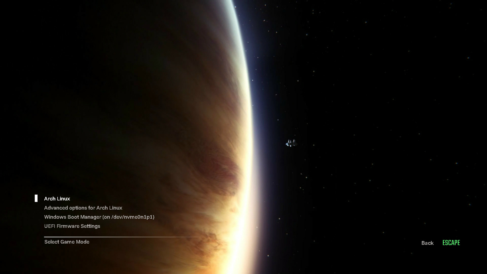

# Space Isolation
A GRUB theme based on the main menu of the 2014 survival horror game Alien: Isolation™.



## Installation
> [!IMPORTANT]
> This theme is a WIP **only supporting 2560x1440 and 1920x1080** resolutions. It will not look optimal on different resolutions. Feel free to add support for your resolutions using [this contribution guide](CONTRIBUTING.md).

1. Download the Space Isolation theme from [releases](https://github.com/callmenoodles/space-isolation/releases) or [Pling](https://www.pling.com/p/2296342/) for your resolution.
2. Rename the directory to `space-isolation`
3. Copy the directory you renamed `space-isolation` to `/boot/grub/themes`
    ```
    # cp -r /path/to/space-isolation /boot/grub/themes
    ```
4. Edit `/etc/default/grub` (as a superuser)
    - Set `GRUB_THEME=` TO `/boot/grub/themes/space-isolation/1920x1080/theme.txt`
    - Make sure `GRUB_TERMINAL_OUTPUT="gfxterm"`
    - Set `GRUB_GFXMODE=` to your resolution (e.g. `1920x1080`) and uncomment it 
5. Update GRUB
    - Arch Linux
        ```
        # grub-mkconfig -o /boot/grub/grub.cfg
        ```
    - Fedora
        ```
        # grub2-mkconfig -o "$(readlink -e /etc/grub2.conf)"
        ```
    - OpenSUSE
        ```
        # update-bootloader
        ```
    - Ubuntu/Debian, Void Linux
        ```
        # update-grub
        ```
